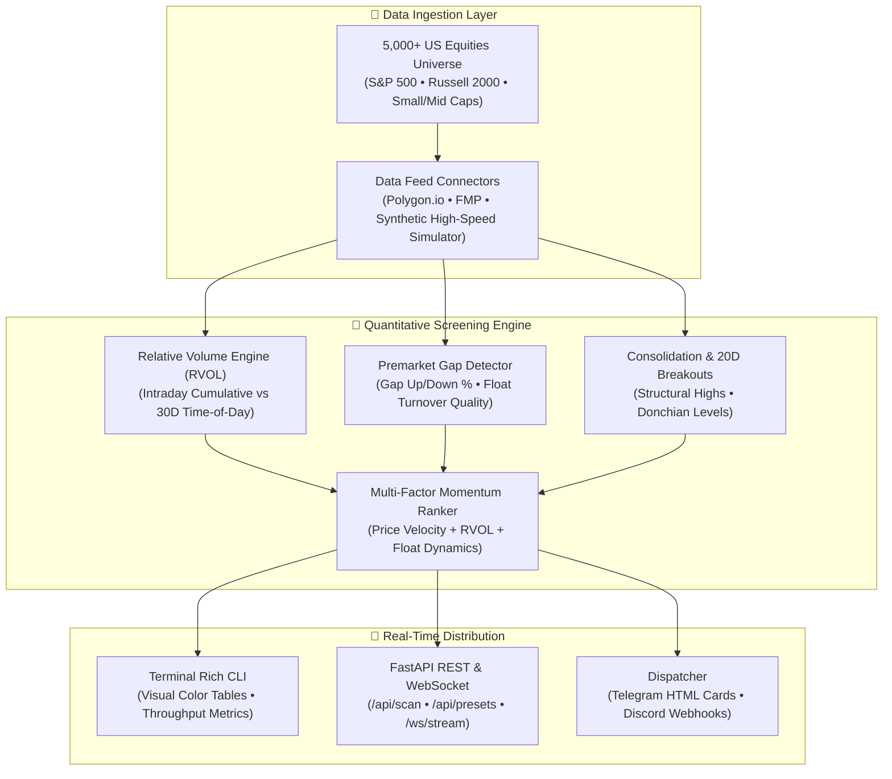

# 🔍 OpenMarketScanner — High-Throughput 5,000+ US Equities Market Scanner

[](https://python.org)
[](https://fastapi.tiangolo.com)
[](https://github.com/jahanzaib-codes/OpenMarketScanner)
[](https://telegram.org)
[](https://opensource.org/licenses/MIT)

> An institutional-grade, high-throughput quantitative market scanner screening **5,000+ US Equities** in real-time. Screens **Premarket Movers, Gap Up/Down, Relative Volume (RVOL) Surges, Consolidation Breakouts**, and calculates a multi-factor **Cross-Sectional Momentum Score** with automated Telegram alerts and WebSocket live feeds.

---

### 💼 Need Custom Quantitative Systems, Trading Bots, or Scanners?
I build high-frequency algorithmic execution engines, custom market scanners, and automated broker integrations for hedge funds, prop trading desks, and private syndicates.
* 💬 **Telegram:** [@JanzebBlockdev](https://t.me/JanzebBlockdev)
* 💼 **Fiverr Profile:** [Verified Quantitative Developer (Fiverr)](https://tinyurl.com/2wruxnsx)
* 📧 **Email:** `jahanzaibchanna70@gmail.com`

---

## 🏗️ System Architecture



---

## ⚡ Key Capabilities

1. **🚀 Sub-Second 5,000+ Equities Screening**
   * Processes the entire US equity universe (S&P 500, Russell 2000, active small-caps) with sub-second latency via an asynchronous parallel batching pipeline.

2. **📊 Institutional Relative Volume (RVOL)**
   * Compares real-time volume against normal time-of-day expectations, identifying true institutional accumulation/distribution rather than standard closing spikes.

3. **🌅 Premarket Gapper & Float Rotation Detection**
   * Automatically screens premarket movers gapping $\pm 3\%$ to $+35\%$ before the 9:30 AM EST opening bell. Categorizes candidates by float velocity (A+ Runners vs Chop).

4. **💥 Structural 20-Day Breakout Engine**
   * Detects clean price breakouts above 20-day highs or breakdown below 20-day lows confirmed by volume expansion.

5. **🧮 Multi-Factor Momentum Conviction Score (0-100)**
   * Synthesizes price velocity ($35\%$), volume expansion ($35\%$), resistance breakout ($20\%$), and low-float rotational bonus ($10\%$) into a single ranked metric.

6. **📱 Automated Telegram & Discord Alert Cards**
   * Dispatches clean HTML formatting cards with ticker symbols, direct TradingView chart links, RVOL conviction, and trigger catalysts.

---

## 🖥️ Terminal CLI Output Preview

```
┏━━━━━━━━┳━━━━━━━━━━━━━┳━━━━━━━━━━┳━━━━━━━━┳━━━━━━━━━━━━┳━━━━━━━┳━━━━━━━━━━━━━━━━━━━━┳━━━━━━━━━━━━━━━┳━━━━━━━━━━━━━━━━━━━━┓
┃ Symbol ┃       Price ┃    Gap % ┃   RVOL ┃     Volume ┃ Score ┃ Trigger            ┃ Quality       ┃ Sector             ┃
┡━━━━━━━━╇━━━━━━━━━━━━━╇━━━━━━━━━━╇━━━━━━━━╇━━━━━━━━━━━━╇━━━━━━━╇━━━━━━━━━━━━━━━━━━━━╇━━━━━━━━━━━━━━━╇━━━━━━━━━━━━━━━━━━━━┩
│ NVDA   │     $144.20 │   +4.80% │   4.2x │ 58,300,000 │  88.5 │ 20D_BREAKOUT       │ HIGH_MOMENTUM │ Technology         │
│ SMCI   │      $38.50 │  +12.40% │   5.8x │ 14,200,500 │  86.2 │ GAP_UP_12.4%       │ A_PLUS_RUNNER │ Technology         │
│ MSTR   │     $245.80 │   +6.20% │   3.4x │  6,800,200 │  79.1 │ 20D_BREAKOUT       │ HIGH_MOMENTUM │ Financial Services │
│ PLTR   │      $44.10 │   +3.50% │   2.8x │ 22,400,000 │  74.0 │ RVOL_2.8x          │ TRADABLE_GAP  │ Technology         │
│ TSLA   │     $288.40 │   -3.80% │   2.4x │ 34,100,000 │  68.2 │ GAP_DOWN_3.8%      │ TRADABLE_GAP  │ Consumer Cyclical  │
└━━━━━━━━┴━━━━━━━━━━━━━┴━━━━━━━━━━┴━━━━━━━━┴━━━━━━━━━━━━┴━━━━━━━┴━━━━━━━━━━━━━━━━━━━━┴━━━━━━━━━━━━━━━┴━━━━━━━━━━━━━━━━━━━━┘
Screened: 5,000 equities | Matches: 48 | Time: 0.082s | Throughput: 60,975 tickers/sec
```

---

## 🚀 Quickstart

### 1. Installation

```bash
git clone https://github.com/jahanzaib-codes/OpenMarketScanner.git
cd OpenMarketScanner
python -m venv .venv

# Windows
.venv\Scripts\activate
# Linux / macOS
source .venv/bin/activate

pip install -r requirements.txt
```

### 2. Environment Setup

Copy example environment variables:
```bash
cp .env.example .env
```

Edit `.env` (optional — works out-of-the-box in Simulator mode without API keys):
```ini
DEFAULT_DATA_PROVIDER=simulator    # options: simulator, polygon
MIN_STOCK_PRICE=2.00
MAX_STOCK_PRICE=500.00
MIN_RVOL_THRESHOLD=2.0             # 2.0x normal volume
MIN_GAP_PERCENT=3.0                # Minimum 3% gap

# Real-Time Alerts
ENABLE_TELEGRAM_ALERTS=false
TELEGRAM_BOT_TOKEN=your_token
TELEGRAM_CHAT_ID=your_chat_id
```

### 3. Run Interactive Terminal Scanner

```bash
# Scan Premarket Gappers
python scanner_cli.py --preset PREMARKET_GAPPERS

# Scan Unusual Volume Surges (RVOL >= 3.0x)
python scanner_cli.py --preset UNUSUAL_RVOL

# Scan 20-Day Resistance Breakouts
python scanner_cli.py --preset MOMENTUM_BREAKOUT --limit 20
```

### 4. Run FastAPI REST & WebSocket Server

```bash
python main.py
```
Open **[http://127.0.0.1:8000/docs](http://127.0.0.1:8000/docs)** to view the interactive OpenAPI / Swagger interface.

---

## 📡 REST API & WebSocket Specifications

| Method | Endpoint | Description |
| :--- | :--- | :--- |
| `GET` | `/api/health` | Returns health status, screened universe size, and active provider. |
| `GET` | `/api/scan` | Runs custom scan (`min_price`, `max_price`, `min_rvol`, `min_gap_pct`, `preset`). |
| `GET` | `/api/presets/{name}` | Fast preset scanner (`PREMARKET_GAPPERS`, `UNUSUAL_RVOL`, `MOMENTUM_BREAKOUT`). |
| `GET` | `/api/universe/stats` | Sector breakdown and market capitalization distributions. |
| `WS` | `/ws/stream` | Continuous real-time WebSocket broadcasting momentum triggers. |

---

## 📄 License

Distributed under the **MIT License**. See `LICENSE` for details.

---

### 🌟 Maintained by **Jahanzaib**
* **GitHub:** [@jahanzaib-codes](https://github.com/jahanzaib-codes)
* **Fiverr:** [Hire for Quant & Trading Bot Development](https://tinyurl.com/2wruxnsx)
* **Telegram:** [@JanzebBlockdev](https://t.me/JanzebBlockdev)
* **Email:** `jahanzaibchanna70@gmail.com`

